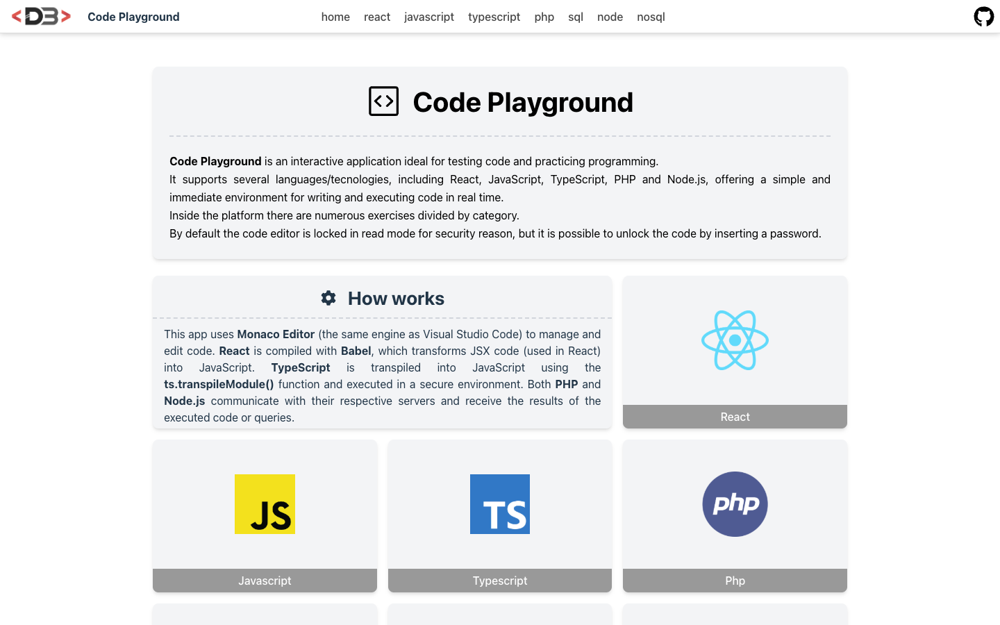
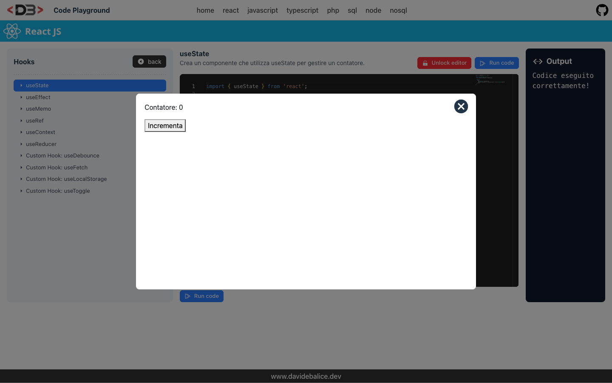

# Code Playground

An interactive web app for practicing programming and testing code in the browser. It includes hundreds of exercises, divided by category, for React, JavaScript, TypeScript, PHP, SQL, Node.js and MongoDB, with a VS Code–like editor and live output.





## Features

- Exercises grouped by language and category, with pagination
- Code editor based on Monaco Editor (the engine of Visual Studio Code)
- **React**: JSX compiled in the browser with Babel and rendered in a sandboxed iframe
- **JavaScript** and **TypeScript**: run in the browser (TypeScript transpiled with `ts.transpileModule()`)
- **PHP** and **SQL**: code/queries sent to a PHP backend that returns the output or the query results as a table
- **Node.js** and **NoSQL (MongoDB/Mongoose)**: code sent to a Node.js backend that runs it in a sandbox
- Editor locked in read-only mode by default; it can be unlocked with a secret code
- Responsive layout

## Tech stack

### Frontend

- [React 18](https://react.dev/) with TypeScript
- [Vite](https://vite.dev/)
- [Tailwind CSS 4](https://tailwindcss.com/)
- [Monaco Editor for React](https://github.com/suren-atoyan/monaco-react)
- [React Router 7](https://reactrouter.com/)
- [React Icons](https://react-icons.github.io/react-icons/)

### Backends (optional, needed only for PHP/SQL and Node.js/NoSQL exercises)

- `backend-php/` – PHP + MySQL (PDO)
- `backend-node/` – Node.js, Express, Mongoose, vm2

## Getting started

### Requirements

- Node.js 20 or later
- npm
- PHP and MySQL (for the PHP/SQL exercises)
- MongoDB (for the Node.js/NoSQL exercises)

### Installation

```bash
git clone https://github.com/davidebalice/code-playground.git
cd code-playground
npm install
```

### Configuration

Create a `.env` file in the project root:

```env
VITE_SECRET_CODE=your_secret_code
VITE_PHP_BACKEND=http://localhost/backend-php/
VITE_NODE_BACKEND=http://localhost:8000
```

| Variable            | Description                                                      |
| ------------------- | ---------------------------------------------------------------- |
| `VITE_SECRET_CODE`  | Code that unlocks the editor (otherwise it stays read-only)      |
| `VITE_PHP_BACKEND`  | URL of the `backend-php` folder (with trailing slash)            |
| `VITE_NODE_BACKEND` | URL of the Node.js backend (no trailing slash)                   |

#### PHP backend

Serve the `backend-php` folder with PHP, import `backend-php/db.sql` into a MySQL database and create `backend-php/config.php` (not committed):

```php
<?php
return [
    'host' => 'localhost',
    'dbname' => 'playground',
    'username' => 'user',
    'password' => 'password',
];
```

#### Node.js backend

`backend-node/server.js` is an Express server listening on port 8000. It reads the MongoDB connection string from the `MONGO_URI` environment variable and expects the Mongoose models `Product`, `User` and `Order` in `backend-node/models/`.

### Available scripts

| Command           | Description                                      |
| ----------------- | ------------------------------------------------ |
| `npm run dev`     | Start the development server                     |
| `npm run build`   | Type-check and create a production build in `dist/` |
| `npm run preview` | Preview the production build locally             |
| `npm run lint`    | Run ESLint                                       |

## API endpoints

| Backend | Method | Endpoint         | Description                                  |
| ------- | ------ | ---------------- | -------------------------------------------- |
| PHP     | POST   | `/server.php`    | Execute PHP code (`{ "code": "..." }`)       |
| PHP     | POST   | `/server-db.php` | Execute an SQL query (`{ "query": "..." }`)  |
| Node.js | POST   | `/execute`       | Execute Node.js code (`{ "code": "..." }`)   |
| Node.js | POST   | `/query`         | Execute a Mongoose query (`{ "code": "..." }`) |

> The backends execute user-submitted code. Use them only in a controlled environment.

## Project structure

```
src/
├── components/   # One playground per language, navbar, modal, secret code form
├── data/         # Exercises for each language
├── css/          # CSS modules
└── main.tsx      # Application entry point
backend-php/      # PHP and SQL execution endpoints, sample database
backend-node/     # Node.js and MongoDB execution server
```

## Author

**Davide Balice** – [davidebalice.dev](https://www.davidebalice.dev)
